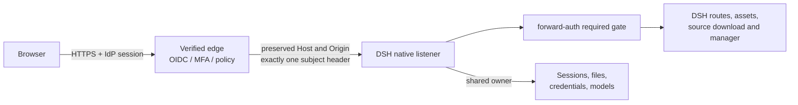

# Architecture

This page explains what is inside each image, how a request crosses the trust
boundary, and which repository changes are allowed to affect which upstream.

## Images and profiles

| Image | Release tag | Profile | Purpose |
| --- | --- | --- | --- |
| `ghcr.io/soulwhisper/dsh-web:0.2.1-rc.2` | `web-0.2.1-rc.2` | DSH Web, `dshmarket`, `dsh-context`, required forward-auth | General DSH Web with owner-approved community plugins |
| `ghcr.io/soulwhisper/dsh-tavern:3.0` | `tavern-3.0` | Custom Tavern workspace, forward-auth, ecosystem | Dedicated Tavern instance |

Both images use Node 24/glibc, UID/GID `1000:1000`, `tini`, a read-only root
filesystem, and a native DSH listener on port `3080`. They are built natively for
`linux/amd64` and `linux/arm64`; there is no QEMU path.

The Tavern image additionally retains the complete modified Tavern source at
`/opt/apps/dsh-tavern` and an authenticated corresponding-source archive at
`/opt/dsh-source/tavern.tar.gz`. The archive contains Tavern source plus the
distribution build inputs, not installed dependencies or user data. See
[Corresponding source](source-build.md).

## Trust path

The edge performs OAuth/OIDC login, MFA, session validation and access policy.
It must remove client-supplied identity headers and inject exactly one configured
subject header.

The local plugin enforces the real TCP peer CIDR and identity header on every
HTTP request and WebSocket upgrade. It covers static assets, source downloads and
the native manager. A clean authenticated index request exchanges a native
`HttpOnly; SameSite=Strict` cookie inside the process; no launch token is returned
in a URL.

The gate is mandatory. If the plugin is missing, unloaded or fails validation,
the Host has no unguarded route. The edge must still restrict network reachability
to the listener; the CIDR allowlist is a second layer, not a replacement for
network policy. See [Authentication](forward-auth.md).

## Repository boundaries

The repository is deliberately split so an upstream break stays local to one
surface.

| Path | Owns | A break stays local to |
| --- | --- | --- |
| `patches/dsh/` | Host gate, startup audit, manager policy | DSH host/manager/app-boot files and exact anchors |
| `patches/market/` | Market-to-native-manager bridge | dshmarket artifact and one anchor |
| `patches/tavern/` | Tavern Origin fence and theme limit | Tavern route/theme sources; route and theme hashes |
| `plugins/forward-auth/` | Own authentication plugin, notices, native Connection exchange | This package's API contract and DSH Connection APIs |
| `docker/` | Dockerfile, runtime closure, profile workspaces/locks | Build graph, Node/native ABI, pnpm lock format |
| `scripts/` | Build, state migration, readiness and verification | Maintenance tooling; not a separate runtime |
| `test/` | Behavioral and packaging regressions | Test harness only |
| `docs/` | Durable contracts, plans and source/license text | Documentation and compliance wording |
| `deploy/` | Compose/Kubernetes application examples | Example topology; the real edge and IdP remain external |
| `.github/` | CI, release, labels and review policy | Automation permissions and release route |

The Docker build context is the repository root, but final images receive only
the explicit `distribution-source` payload. Test, smoke, deploy, CI and general
documentation trees are not copied into either image.

## Filesystem map

| Area | Examples | Nature |
| --- | --- | --- |
| Immutable image | `/opt/dsh/runtime`, `/opt/dsh-seed`, `/opt/dsh/profiles`, `/opt/apps/dsh-tavern`, `/opt/dsh-source` | Read-only, replaced by image |
| Durable DSH state | `/data/dsh` profiles, sessions, storages, attachments, credentials | Back up encrypted |
| Durable home | `/data/home` HOME, XDG config/data, pnpm home | Back up |
| Durable projects | `/workspace` | Back up consistently with DSH state |
| Rebuildable cache | `/cache` and `$DSH_HOME/cache` symlink | May be lost |
| Diagnostics | `/logs` and `$DSH_HOME/logs` symlink | Sensitive, not authoritative |
| Local rollback | `/backups` | Not an independent backup |
| Scratch | `/tmp` | tmpfs, may be `noexec` |

The entrypoint materializes state first, then points DSH's hard-coded
`$DSH_HOME/cache` and `$DSH_HOME/logs` paths at the dedicated volumes. Migration
backups exclude those two subtrees. The authoritative table and backup policy are
in [State and backup](data-layout.md).

## What is intentionally absent

Neither final image contains Chromium, a GUI, X11, VNC, a TCP relay, a local
password database, a bootstrap admin, an OIDC client or a replacement mux server.
Browsers are CI test dependencies only.

## Release identity

Only `web-<dsh-version>` and `tavern-<version>` tags publish. The tag must match
`versions.json`, point into `main`, and pass native amd64 and arm64 builds plus
final-image smoke. The combine job creates one multi-arch index. There is no
floating `latest` image tag and no branch candidate image; the three optional
upstream assets are build-time floats, not image tags. Deploy the resulting
digest, not a mutable tag. See [Build and release](build.md).
