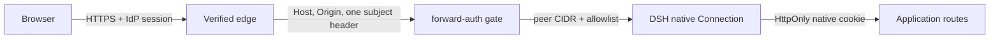

# Authentication

The authentication plugin is `@soulwhisper/dsh-forward-auth`. It is a
trusted-edge **forward-auth** adapter, not an OIDC client, password database,
bootstrap admin or multi-user system.

## Model



The edge performs login, MFA, session validation and policy. The local plugin:

- accepts requests only from a real peer in
  `DSH_FORWARD_AUTH_TRUSTED_PROXY_CIDRS`;
- reads exactly one header named by `DSH_FORWARD_AUTH_HEADER`;
- requires the value to match `DSH_FORWARD_AUTH_ALLOWED_SUBJECTS`;
- rejects duplicate/missing identity, duplicate Host/Origin/Cookie and malformed
  request headers;
- rejects any request whose query contains a `token` parameter, including the
  upstream DSH launch-token URL and WebSocket upgrades;
- mints the native DSH cookie through the native Connection only after the native
  Host/Origin fence accepts the request.

There is no local password, bootstrap admin, admin/user panel, OIDC discovery,
client secret, JWKS cache, login route or `auth-disabled` mode. Missing or broken
configuration fails closed and leaves application routes denied.

## Configuration

| Variable | Required | Meaning |
| --- | --- | --- |
| `DSH_FORWARD_AUTH_HEADER` | Yes | Exactly one header injected by the verified edge |
| `DSH_FORWARD_AUTH_ALLOWED_SUBJECTS` | Yes | Comma-separated stable subjects allowed to become the shared owner |
| `DSH_FORWARD_AUTH_TRUSTED_PROXY_CIDRS` | Yes | Concrete peer CIDRs allowed to reach the listener |
| `DSH_FORWARD_AUTH_MAX_CONNECTION_SECONDS` | No | Positive upgrade lifetime; defaults to `900` |

```text
DSH_FORWARD_AUTH_HEADER=x-authentik-uid
DSH_FORWARD_AUTH_ALLOWED_SUBJECTS=stable-owner-id
DSH_FORWARD_AUTH_TRUSTED_PROXY_CIDRS=10.42.0.17/32
DSH_FORWARD_AUTH_MAX_CONNECTION_SECONDS=900
```

Authentik commonly injects `x-authentik-uid`. Authelia can inject `Remote-User`;
use its exact deployed header name and a stable subject. Do not use email or
display name as the subject allowlist. The header name is configurable; no
provider-specific callback or path is assumed.

The edge must remove client-supplied identity headers, set exactly one configured
header, preserve public Host/Origin, and forward WebSocket upgrades. Restrict the
DSH listener so only the edge can connect, in addition to the plugin's CIDR check.

## First start

Forward-auth has no OIDC first-run problem:

- no discovery, client registration or client-secret fetch is needed;
- the plugin validates only local configuration;
- the first request through the configured edge is admitted after the header
  check;
- if the edge is not ready, requests are denied; there is no password page or
  fallback path.

The plugin starts and logs `waiting-for-edge`; application data remains denied
until a verified edge identity arrives. Direct access is never allowed.

## Status logs

Status lines are fixed and contain no subject, cookie, token or header value:

```text
forward-auth: starting mode=forward-auth header=x-authentik-uid subjects=1 trustedProxyCidrs=1
forward-auth: state=waiting-for-edge provider=external verifiedIdentity=no
forward-auth: state=ready gate=required; waiting-for-edge
forward-auth: state=active provider=external verifiedIdentity=yes
forward-auth: state=waiting-for-edge reason=missing-identity; edge/provider has not injected a subject; direct access remains denied
forward-auth: state=degraded reason=untrusted-peer; request did not come from a trusted edge peer; direct access remains denied
forward-auth: state=broken reason=configuration
forward-auth: state=broken reason=webserver-contract
forward-auth: state=broken reason=connection-contract
forward-auth: state=broken reason=native-cookie
forward-auth: state=broken reason=readiness
forward-auth: state=stopped
```

Denial lines are rate-limited per reason. “Provider not ready” cannot be observed
directly by DSH; `missing-identity` means the edge did not inject the configured
header, which is the expected symptom of an edge/provider that is not ready or a
request that bypassed it. Configuration/native-contract failures are reported as
`state=broken` and fail closed.

The upstream DSH startup URL can still contain a launch token in stdout. Treat
container logs as sensitive; the gate rejects that URL as an authentication path,
but log access itself must be restricted.

## Edge examples

### Authentik

```text
DSH_FORWARD_AUTH_HEADER=x-authentik-uid
DSH_FORWARD_AUTH_ALLOWED_SUBJECTS=<stable Authentik UID>
DSH_FORWARD_AUTH_TRUSTED_PROXY_CIDRS=<edge Pod CIDR>
```

The edge's ext-auth response must forward exactly one `x-authentik-uid`. Do not
trust client-supplied `x-authentik-*` headers.

### Authelia

```text
DSH_FORWARD_AUTH_HEADER=Remote-User
DSH_FORWARD_AUTH_ALLOWED_SUBJECTS=<stable Authelia username>
DSH_FORWARD_AUTH_TRUSTED_PROXY_CIDRS=<edge Pod CIDR>
```

Verify the deployed Authelia forward-auth response header and make usernames
stable. If the edge cannot provide a stable subject, terminate at a different
trusted edge; do not fall back to email or a local password.

## Readiness

Readiness is local only:

```bash
node /opt/dsh/scripts/readiness.mjs
```

It connects to `/tmp/dsh-forward-auth-ready.sock` and succeeds only after the
startup audit and while the gate is registered. It does not prove the edge, IdP,
model provider or sandbox works.

## Single owner

All admitted subjects are the same DSH owner and share files, tools, model
credentials and history. This is not multi-user isolation. A single DSH instance
has no per-user session ownership; use one instance per mutually untrusted owner
if isolation is required.
